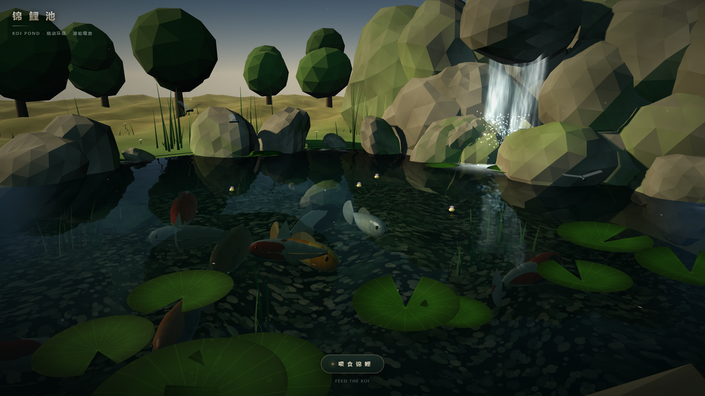

# Koi Pond

**Not a webpage — a renderer. One HTML file, zero assets, every shader hand-written.**

A living koi pond that fits in a single `index.html`: waterfall, rocks, lily pads, lotus flowers, and 11 koi that actually swim over when you feed them.

No build step. No models. No textures. No npm install. Open the file and it runs.

[](docs/demo.mp4)

▶ **[Watch the 21s demo](docs/demo.mp4)**

---

## Live

- Demo: `https://rayares.github.io/koi-pond/` (GitHub Pages)
- Everything is in [`index.html`](index.html) — ~2,300 lines, ~83 KB

## Controls

| Action | Desktop | Mobile |
| --- | --- | --- |
| Orbit | drag | one-finger drag |
| Zoom | scroll wheel | pinch |
| Feed the koi | click **喂食锦鲤** or press `Space` | tap the button |

## What's actually in there

### Two-layer water

The single biggest lesson: **alpha-blending one plane never looks like water.** It's two decoupled shaders.

- **Pond bed** (`pondFloor`) — pebble texture sampled through an analytic wave-gradient UV offset (fake refraction), two octaves of caustics added on top, plus a radius-based depth tint so the middle reads deep and the edges read shallow.
- **Surface** (`waterMat`) — fresnel, specular, foam near the waterfall, and a real planar reflection. Very low base alpha; the depth comes from the bed, not from the surface.

### Real planar reflection

A 768² half-float render target, a mirrored virtual camera (`position.y` negated, `up = (0, -1, 0)`), and `texture2DProj` in the water shader.

Two things that will bite you:

- The projected UV goes out of range at the edges and clamps into a hard grey block. Fix: `smoothstep` fade to sky colour near the borders.
- The render target already went through tone mapping. Sampling it and tone mapping again double-compresses everything — compensate with a ~0.74 multiplier.

### Koi

One merged `BufferGeometry` per fish (body + tail fan + dorsal fin), with an `aBend` attribute running 0 at the head to 1 at the tail. The vertex shader applies a traveling sine wave along that attribute — the fish bends, not the mesh. Phase is accumulated in JS (`swimPhase += dt * freq`) rather than `uTime * uFreq`, otherwise the tail snaps whenever the swim speed changes.

11 fish across 8 varieties (kohaku, sanke, showa, ogon, asagi…), each with a procedurally painted pattern.

### Everything is generated

All textures are drawn to an offscreen `<canvas>` at load time: pebbles, koi patterns (with a scale grid), lily pads, lotus petals, fish shadows. There is not a single image file in the repo — the PNGs in `docs/` are screenshots, not assets.

### Feeding is a state machine, not an animation

`wander` → `feed`. On click, pellets spawn at a random point on the surface; each fish picks the nearest landed pellet, speeds up ~1.85×, rises to a target depth, and eats when it's within range. A short cooldown stops one fish from vacuuming the whole patch in three frames.

## Run locally

```bash
git clone https://github.com/RayAres/koi-pond.git
cd koi-pond
open index.html      # or just double-click it
```

Double-clicking the file works — three.js is pulled from a CDN with four fallbacks (jsdelivr → unpkg → esm.sh → cdnjs), so no local server is required.

## Notes

- Requires WebGL2. Tested on Chrome / Edge with hardware acceleration; runs ~120 fps at 1080p on an RTX 4060 Ti.
- If the pond renders as a flat white blob, a caustic function is overflowing. Clamp it — `pow()` on a value near zero explodes fast and additive blending turns the whole scene white.
- Built with AI assistance, iterating on screenshots: the caustic overflow, the reflection edge block, and the fish reading as flat cutouts were all found by rendering and looking, not by an error message.

## 中文说明

一个装进单文件 `index.html` 的锦鲤池：瀑布、岩石、荷叶、荷花，11 条花纹各异的锦鲤，点「喂食锦鲤」它们会真的游过来抢食。

没有构建流程、没有模型文件、没有贴图——所有纹理都在运行时用 canvas 现画，three.js 从 CDN 动态引入并带四路回退，双击 HTML 就能跑。

技术上值得看的是三块：**水体拆成两层 shader**（池底负责折射/焦散/深度染色，水面只负责菲涅尔/高光/泡沫/平面反射）、**自建平面反射**（镜像虚拟相机 + 768² HalfFloat RT + 投影采样）、**鱼的摆尾在顶点着色器里做行波弯曲**（`aBend` 从 0 到 1 的属性驱动，相位在 JS 里累加）。

拖拽环绕，滚轮或双指缩放，按钮或空格喂食。
